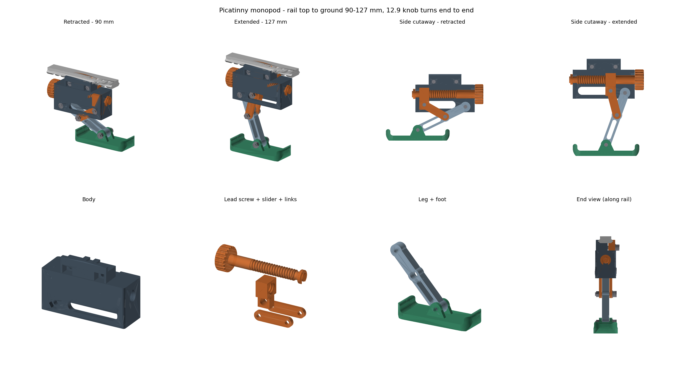

# Picatinny rear monopod

A parametric, 3D-printable rear monopod that clamps to a Picatinny
(MIL-STD-1913) rail, designed for the rear stock rail on a Tikka T3x TACT A1.
Turning a knob drives a printed lead screw, which raises or lowers the leg
through a linkage.

Generated with [CadQuery](https://github.com/CadQuery/cadquery) from
`params.json`.



## Design

Knob → printed lead screw (along the rail) → slider → twin links → leg arm →
pivoting sled foot.

- **Rail clamp:** a fixed jaw on the body and a separate moving jaw. The
  clamp bolts run under the rail into captive nuts, and printed recoil lugs
  sit in the rail's cross slots.
- **Range:** rail to ground 93 to 128 mm, 12.6 knob turns end to end.
  Clockwise from the knob end is up; the knob is engraved "UP".
- **Hardware:** 6 × M5×25 socket head bolts, washers and plain hex nuts.

## Print it

- **Material:** PETG for strength. The included Bambu Studio project
  (`monopod_body.3mf`, Bambu PETG HF on an A1) uses 6 walls, 100% infill and
  255 °C.
- No supports. The body prints as assembled (channel down), the slider
  standing on end, the screw knob-down, the leg and links flat, the foot
  deck-down.
- **Files:** `monopod_*.stl` (print orientation) and rail clamp test pieces
  in `fit_test/`. A `JAW_LIP` of 1.5 fits the TACT A1 rail best.

## Generate

```bash
python -m venv venv
venv\Scripts\pip install -r requirements.txt
venv\Scripts\python generate.py
venv\Scripts\python fit_test.py 1.5 2.0 2.5     # rail clamp test pieces
```

All lengths are in mm.

## Status

Designed and fit-tested on the rail clamp; first full print and fit on the
rifle still to come.

## License

[MIT](LICENSE)
